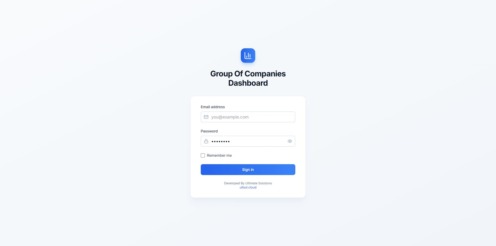
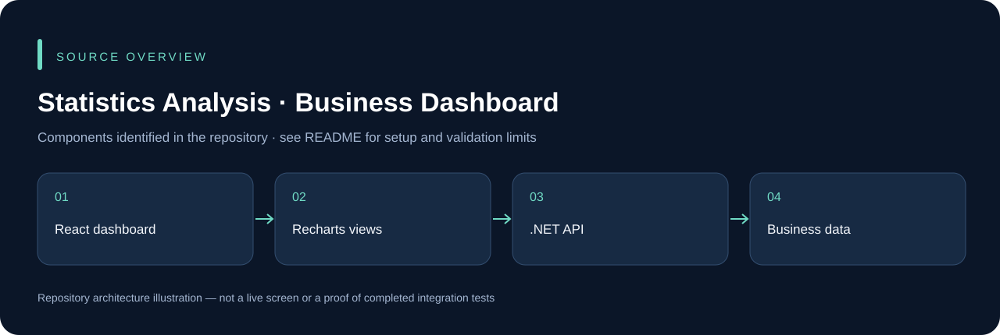

# Statistics Analysis · Business Dashboard

A React/TypeScript dashboard with an ASP.NET Core API for business metrics. The frontend contains sales, purchases, banks, receivables, payables, expenses, invoices, companies, reports and settings views, with Recharts-based visualization components.

## Run locally

```powershell
cd statisticsWeb
npm ci
npm run dev
```

Set the intended API endpoint in the client configuration. Run the API separately with `dotnet run --project statisticsBackend/StatisticsBackend/StatisticsBackend.csproj`, supplying a compatible private database and authentication settings. A missing operational SQL schema cannot be replaced by fabricated dashboard figures.

The new screenshot shows the real sign-in interface from the local frontend. Authentication and financial data were not bypassed or fabricated. The review also removes the prefilled password from the login form; users should enter their own credentials.

## Application preview



Captured from the actual locally running React frontend on 14 November 2026. No authenticated financial data or backend transaction is shown.

## Source overview



This diagram is derived from the repository structure; it is not an application screenshot.

## Development and validation

Use an isolated development database and synthetic records. Keep credentials, device sessions, signing keys and operational uploads outside Git. The presence of source code does not establish that every integration or deployment scenario has been tested. See [repository review](docs/REPOSITORY_REVIEW.md) for this audit's scope.

## Ownership and contributions

Existing author, template, asset and dependency attributions remain in place. Follow any existing license files; this documentation update does not grant a new license. For a change, describe the affected workflow, configuration and checks so it can be reviewed without guessing.
